 

building things · breaking things · understanding systems

  

  

Software development with a focus on

**backend · mobile · efficient solutions**

  

Currently exploring cybersecurity, CTFs, networks, 
APIs and relational databases.

  

technologies

  

  

Python · C# · .NET · Kotlin · Java 
TypeScript · JavaScript 
PostgreSQL · Linux · Red Hat · Git

  

focus

  

**building**

APIs · backend systems · mobile applications · DevSecOps tools

  

**learning**

Cybersecurity · Networks · Software Architecture

  

**exploring**

Systems · Security · Infrastructure · Development · CTF

  

@nyxaev

